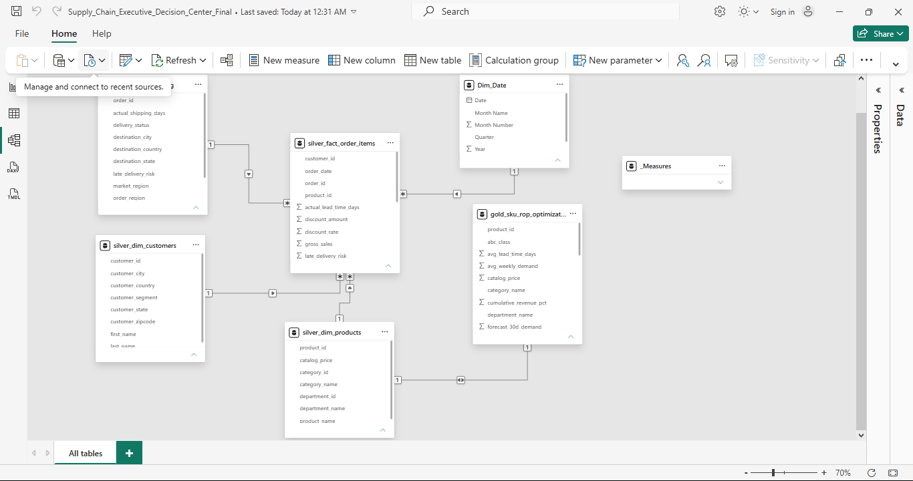
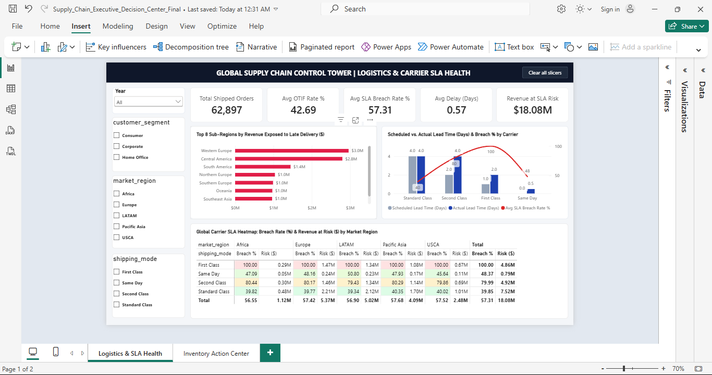
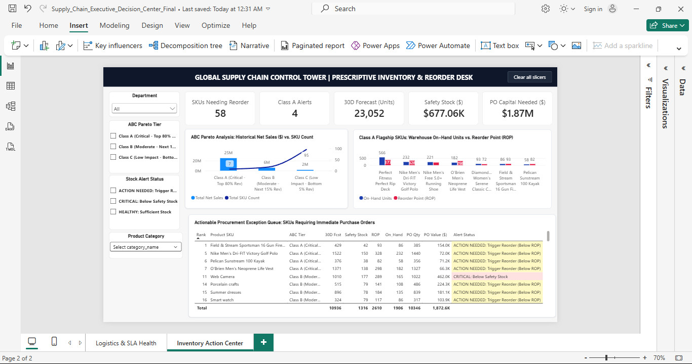

# 🌐 Global Supply Chain Control Tower: End-to-End Medallion Data Engineering, ML Demand Forecasting & Power BI Star Schema

## 📌 Executive Summary
Global supply chain teams often operate in reactive silos—tracking historical carrier delays in one spreadsheet while managing warehouse stockouts in another. 

This project engineers an enterprise **Supply Chain Control Tower** across **180,519 transaction line items ($30.5M+ Net Sales)** using a **MySQL Medallion Architecture (`Bronze -> Silver -> Gold`)**, **Python (`sqlalchemy`, `scikit-learn`)**, and a live **Kimball Star Schema in Power BI**.

### Key Business Quantifications & Discoveries:
* **Logistics SLA Exposure (Page 1):** Across **62,897 shipped orders**, the global On-Time In-Full (OTIF) rate sits at **42.69%** (a **57.31% SLA breach rate**), exposing **$18.08M in Net Sales** to late delivery risk.
* **Root-Cause Carrier Bottleneck:** Diagnostic lead-time analysis proves that **First Class (100% breach rate; 2.0 actual days vs. 1.0 scheduled day)** and **Second Class (79.99% breach rate; 4.0 actual days vs. 2.0 scheduled days)** systematically fail SLA targets across all 5 global market regions, whereas **Standard Class** meets its 4.0-day promise (**39.85% breach rate**).
* **ABC Pareto Concentration (Page 2):** Just **7 Class A SKUs (5.9% of catalog)** drive **~80% of company revenue (~$25M)**, while **95 Class C SKUs** generate under **$2M**.
* **Prescriptive Inventory Optimization:** By modeling 30-day demand (`23,052 units`), dynamic Safety Stock buffers (`$677.06K`), and Reorder Points (ROP) at a 95% service level, the Control Tower flags **58 SKUs** (including **4 critical Class A flagship SKUs**) requiring **$1.87M in immediate Purchase Order (PO) working capital**.

---

## 🏗️ 1. Enterprise Kimball Star Schema (Power BI Model View)
Instead of relying on flat CSV exports, Power BI connects directly to the local **MySQL (`supply_chain_db`)** database via an automated Python (`sqlalchemy` + `pymysql`) ingestion pipeline:
* **Central Fact Table:** `silver_fact_order_items` (180,519 rows; grain = 1 row per order line item).
* **Core Dimension Tables (`1 : *` Single-Direction Filtering):** `Dim_Date`, `silver_dim_shipping` (65,752 orders), `silver_dim_customers` (20,652 customers), and `silver_dim_products` (118 SKUs).
* **Prescriptive ML Extension (`1 : 1` Bi-Directional):** `gold_sku_rop_optimization` (118 SKUs; ABC Pareto tiers, 30-day demand forecasts, dynamic Safety Stock, Reorder Points, and automated PO quantities).

---

## 📊 2. Page 1: Logistics & Carrier SLA Health
* Tracks **Total Shipped Orders (`62,897`)**, **OTIF Rate (`42.69%`)**, **SLA Breach Rate (`57.31%`)**, **Avg Lead Time Delay (`+0.57 Days`)**, and **Revenue at SLA Risk (`$18.08M`)**.
* Pinpoints the Top 8 high-risk sub-regions led by **Western Europe (`$3.0M` at risk)** and **Central America (`$2.8M` at risk)**.
* Cross-tabulates carrier breach rates and revenue exposure across `Africa`, `Europe`, `LATAM`, `Pacific Asia`, and `USCA`.

---

## 📦 3. Page 2: Prescriptive Inventory & Reorder Desk
* Monitors **SKUs Needing Reorder (`58`)**, **Class A Critical Alerts (`4`)**, **30D Forecasted Demand (`23,052 units`)**, **Safety Stock Capital (`$677.06K`)**, and **PO Capital Needed (`$1.87M`)**.
* Compares live warehouse on-hand units against Reorder Points (ROP) for Class A flagship products (*Field & Stream Gun Safe*, *Nike Dri-FIT Polo*, *Pelican Kayak*, *O'Brien Life Vest*).
* Provides a rank-ordered **Actionable Procurement Exception Queue** with automated Purchase Order quantities and capital requirements.

